# Benchmarks: Vanillite vs Paper, Vanilla and Pumpkin

<!-- Generated by `cargo xtask bench` from results/latest.json. Do not edit. -->

Measured automatically every night on the newest dev commit with new code (last run 2026-11-27 04:42 UTC, dev `24e7176e9b65`). Machine-readable: [`results/latest.json`](results/latest.json) (the newest numbers of every scenario), [`results/history.json`](results/history.json) (the compared numbers of every run) and `results/runs/<time>.json` (each run as measured).

## Regressions and improvements

The last run against the run before that measured the same number; listed only beyond the noise (at least 10 % and a small absolute step, more where a number scattered more over the last 10 runs).

**Regressions of Vanillite:**

- Vanillite, Startup time and idle memory: cold start 4.84 → 9.7 s (+100 %, noise threshold ±73 %)
- Vanillite, World save: save-all flush 0.32 → 2.77 s (+776 %, noise threshold ±10 %)
- Vanillite, World save: MSPT p95 while flying 25.98 → 1406 ms (+5311 %, noise threshold ±10 %)

**Improvements of Vanillite:** none.

## How to read these numbers

- **Bots are not players.** The load comes from headless bots (`tools/loadbot`): they log in, walk or fly by simple rules, answer keep-alives and count what they receive. They do not render, click, fight or build, and they send fewer packets than real clients. All servers get exactly the same bots.
- **Hardware:** test server: 4 cores of an AMD Ryzen 9 5950X, 10 GiB RAM, Linux container (Ubuntu 26.04); other test instances on it stay mostly idle during runs. Bots: tools/loadbot on a separate machine in the same LAN (offline mode, no encryption).
- **Same conditions for all:** seed -578941029922802438, normal world, peaceful, view distance 10, simulation distance 10, offline mode, pause-when-empty off, a new world per scenario.
- **Versions and configuration:**
  - Vanillite: Vanillite dev 26.3, release-fast build, rule profile vanilla (paper profile as extra rows); memory limit 6 GiB.
  - Paper: Paper 26.3 build 262, default configuration (Paper's own optimisations on), Java 25, -Xms1G -Xmx6G.
  - Vanilla: Mojang's server.jar 26.3, Java 25, -Xms1G -Xmx6G.
  - Pumpkin: Pumpkin 0.2.2+26.3-26.60 release binary, defaults (no tick time report, so no MSPT).
  - vanillite-proxy: vanillite-proxy from the same commit, modern forwarding.
  - Velocity: Velocity 4.3.1 build 45, Java 25, -Xms512M -Xmx2G, modern forwarding.
- **Tick time (MSPT):** Vanillite: every tick (tick log). Paper and Vanilla: `/tick query` every 5 s (P50/P95/P99/mean of the last 100 ticks), averaged over the window; max is the highest P99 window.
- **One run per night:** expect about ±10 % between runs; look at the history before reading much into one change.
- **What each server can do:** n/a¹ = the server cannot run this scenario (the command or feature is missing; the note says which). error² = the run broke (see the note). failed³ = the server did not reach the load (players dropped, crashed or stopped answering); the ramp stops there. Vanillite is under development: missing commands or features show up here as n/a until they land.

## Summary

One number per scenario and server; the arrow says what is better. In brackets: change against the previous run.

| Scenario | Metric | Vanillite | Vanillite (paper profile) | Paper | Vanilla | Pumpkin | vanillite-proxy | Velocity |
|---|---|---:|---:|---:|---:|---:|---:|---:|
| [Startup time and idle memory](#startup-time-and-idle-memory) | idle RSS (MiB) ↓ | 282 (+7 %) | | 1385 | 1003 | 41.4 | | |
| [Redstone: clocks, dust lines and pistons](#redstone-clocks-dust-lines-and-pistons) | mean MSPT (ms) ↓ | 21.09 | | 14.17 | 16.63 | n/a¹ | | |
| [Entity farm: 500 cows in a pen](#entity-farm-500-cows-in-a-pen) | mean MSPT (ms) ↓ | 6.69 | | 10.4 | 11.3 | – | | |
| [Dropped items: 2 000 item entities](#dropped-items-2-000-item-entities) | mean MSPT (ms) ↓ | 5.96 | | 8.27 | 12.44 | – | | |
| [Hoppers: 1 024 hoppers moving items in rings](#hoppers-1-024-hoppers-moving-items-in-rings) | mean MSPT (ms) ↓ | 4.5 | | 5.33 | 4.78 | n/a¹ | | |
| [TNT: chain explosions](#tnt-chain-explosions) | mean MSPT (ms) ↓ | 12.92 | | 7.98 | 19.08 | – | | |
| [Flowing water and lava](#flowing-water-and-lava) | mean MSPT (ms) ↓ | 4.06 | | 5.05 | 5.28 | – | | |
| [Light updates](#light-updates) | mean MSPT (ms) ↓ | 4.87 | | 4.18 | 5.76 | – | | |
| [World save](#world-save) | save-all flush (s) ↓ | 2.77 (+776 %) | | 1.86 | 5.49 | | | |
| [World pre-generation](#world-pre-generation) | chunks generated per second (chunks/s) ↑ | 248 | | 60.96 | | | | |
| [Proxy relay](#proxy-relay) | proxy CPU at 500 players (%) ↓ | | | | | | 78.02 | 257 |
| [Flying players: chunk delivery](#flying-players-chunk-delivery) | holes near players at 100 boats (%) ↓ | 99.01 | | failed³ | failed³ | 99.94 | | |
| [Players spread out](#players-spread-out) | MSPT p95 at 500 players (ms) ↓ | 552 | 349 | failed³ | failed³ | – | | |
| [Join storm](#join-storm) | time until the 1 000 more are in (s) ↓ | failed³ | failed³ | failed³ | failed³ | failed³ | | |

## Startup time and idle memory

Start with a new world until the server answers a status ping (cold), restart with that world (warm), then RSS and CPU of the empty, ticking server over 30 s. Run 2026-11-27 04:42 UTC on dev `24e7176e9b65`.

| Server | Version | Cold start s | Warm start s | Idle RSS MiB | Idle CPU % |
|---|---:|---:|---:|---:|---:|
| Vanillite | 26.3 | 9.7 | 3.89 | 282 | 0.4 |
| Paper | Paper 26.3 | 19.08 | 11.69 | 1385 | 2.4 |
| Vanilla | 26.3 | 9.35 | 7.98 | 1003 | 0.9 |
| Pumpkin | 26.3 | 0.45 | 0.28 | 41.4 | 0.87 |

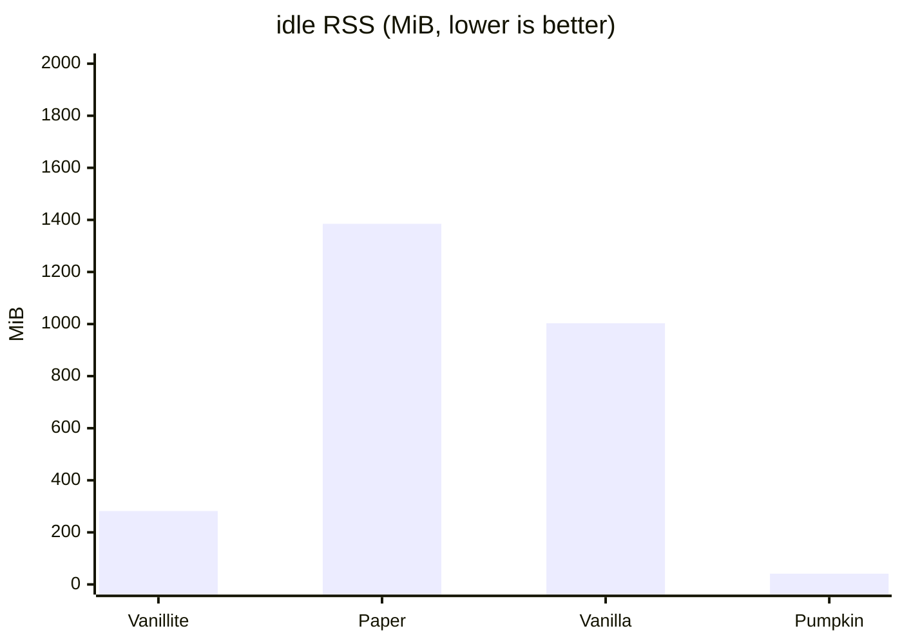

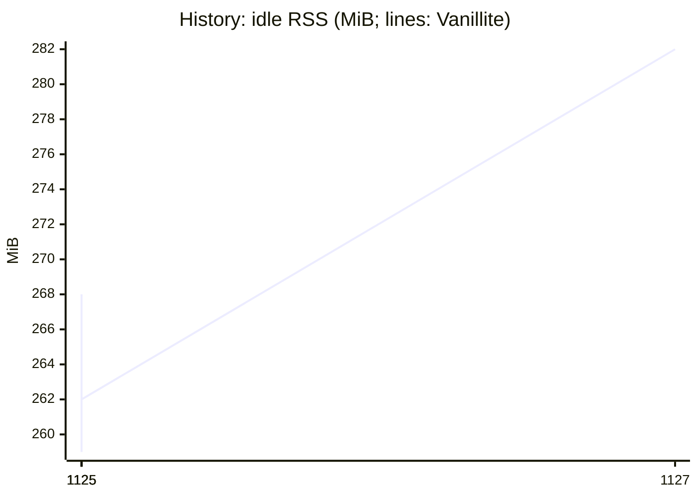

Notes:

- Paper: from an earlier run (2026-11-25 04:09 UTC, dev `unknown`), not measured in this one
- Vanilla: from an earlier run (2026-11-25 04:09 UTC, dev `unknown`), not measured in this one
- Pumpkin: from an earlier run (2026-11-25 04:09 UTC, dev `unknown`), not measured in this one

## Redstone: clocks, dust lines and pistons

93 observer clocks, each driving a 15-block redstone dust line into a sticky piston that moves a block (1 395 dust, 93 pistons), on a platform at y 280. Run 2026-11-27 04:42 UTC on dev `24e7176e9b65`.

| Server | MSPT mean | p50 | p95 | p99 | max | CPU % | RSS MiB |
|---|---:|---:|---:|---:|---:|---:|---:|
| Vanillite | 21.09 | 9.25 | 74.16 | 106 | 321 | 290 | 449 |
| Paper | 14.17 | 9.91 | 32.63 | 41.9 | 55.7 | 43.64 | 1595 |
| Vanilla | 16.63 | 15.16 | 33 | 40.73 | 48.6 | 46.25 | 1325 |
| Pumpkin (unsupported) | n/a¹ | – | – | – | – | – | – |

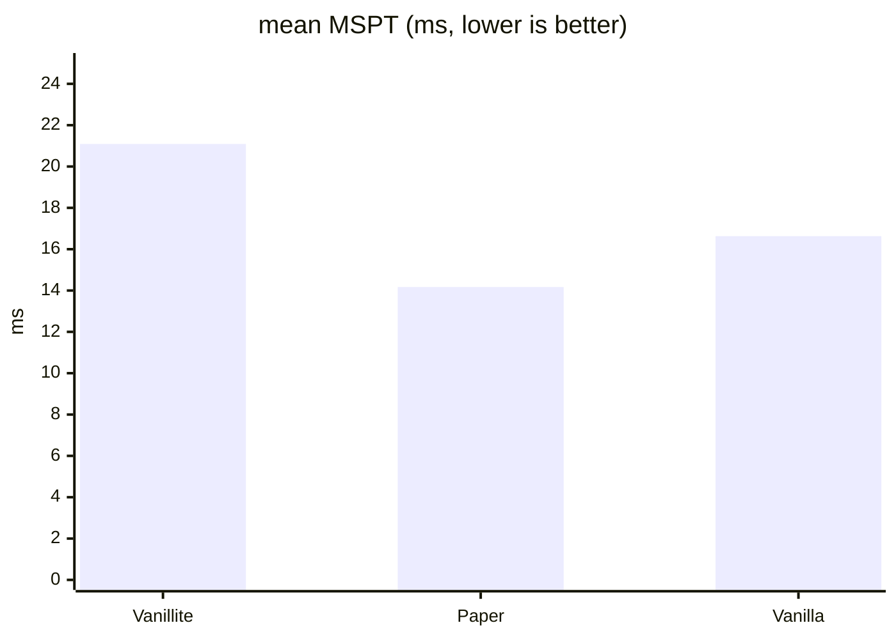

Notes:

- Paper: from an earlier run (2026-11-25 04:09 UTC, dev `unknown`), not measured in this one
- Vanilla: from an earlier run (2026-11-25 04:09 UTC, dev `unknown`), not measured in this one
- Pumpkin: from an earlier run (2026-11-25 04:09 UTC, dev `unknown`), not measured in this one
- Pumpkin: command not supported: ...cky_piston[facing=up]<--[HERE]

## Entity farm: 500 cows in a pen

500 cows summoned on a grid in a 64 × 64 glass pen (mob AI, pathfinding, collisions, tracking for one player). Run 2026-11-27 04:42 UTC on dev `24e7176e9b65`.

| Server | MSPT mean | p50 | p95 | p99 | max | CPU % | RSS MiB |
|---|---:|---:|---:|---:|---:|---:|---:|
| Vanillite | 6.69 | 6.12 | 10.56 | 16.37 | 53.32 | 15.74 | 468 |
| Paper | 10.4 | 10.03 | 14.05 | 25.4 | 51.5 | 29.07 | 1536 |
| Vanilla | 11.3 | 10.66 | 16.44 | 31.07 | 46.3 | 28.82 | 1293 |
| Pumpkin | – | – | – | – | – | 3.29 | 202 |

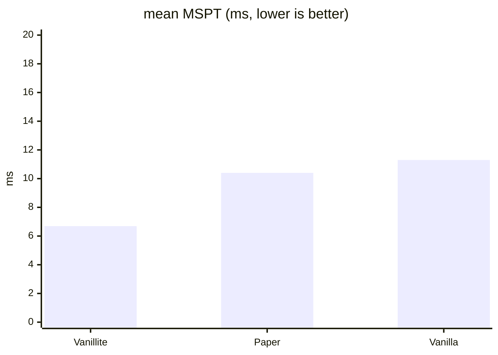

Notes:

- Paper: from an earlier run (2026-11-25 04:09 UTC, dev `unknown`), not measured in this one
- Vanilla: from an earlier run (2026-11-25 04:09 UTC, dev `unknown`), not measured in this one
- Pumpkin: from an earlier run (2026-11-25 04:09 UTC, dev `unknown`), not measured in this one

## Dropped items: 2 000 item entities

2 000 cobblestone item entities 1.25 blocks apart (no merging, no despawn, no pickup) on a platform. Run 2026-11-27 04:42 UTC on dev `24e7176e9b65`.

| Server | MSPT mean | p50 | p95 | p99 | max | CPU % | RSS MiB |
|---|---:|---:|---:|---:|---:|---:|---:|
| Vanillite | 5.96 | 5.44 | 9.94 | 16 | 69.42 | 13.76 | 473 |
| Paper | 8.27 | 7.93 | 11.52 | 17.93 | 34.5 | 23.32 | 1593 |
| Vanilla | 12.44 | 12.11 | 15.68 | 22.24 | 36.2 | 30.75 | 1305 |
| Pumpkin | – | – | – | – | – | 3.02 | 203 |

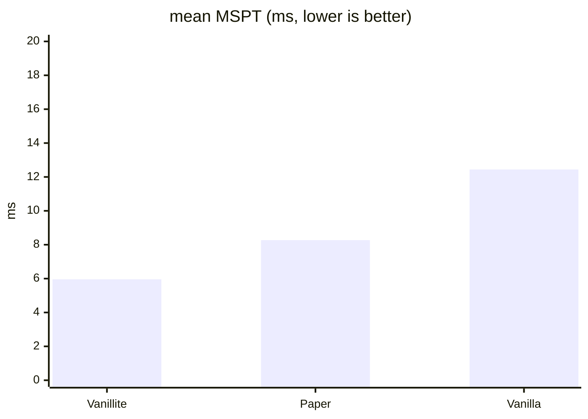

Notes:

- Paper: from an earlier run (2026-11-25 04:09 UTC, dev `unknown`), not measured in this one
- Vanilla: from an earlier run (2026-11-25 04:09 UTC, dev `unknown`), not measured in this one
- Pumpkin: from an earlier run (2026-11-25 04:09 UTC, dev `unknown`), not measured in this one

## Hoppers: 1 024 hoppers moving items in rings

256 rings of 4 hoppers that pass a stack of 64 items around forever. Run 2026-11-27 04:42 UTC on dev `24e7176e9b65`.

| Server | MSPT mean | p50 | p95 | p99 | max | CPU % | RSS MiB |
|---|---:|---:|---:|---:|---:|---:|---:|
| Vanillite | 4.5 | 3.72 | 8.65 | 18.85 | 60.67 | 10.54 | 478 |
| Paper | 5.33 | 5.1 | 6.97 | 20.19 | 39.1 | 18.11 | 1562 |
| Vanilla | 4.78 | 4.62 | 6.53 | 10.65 | 20.8 | 16.25 | 1320 |
| Pumpkin (unsupported) | n/a¹ | – | – | – | – | – | – |

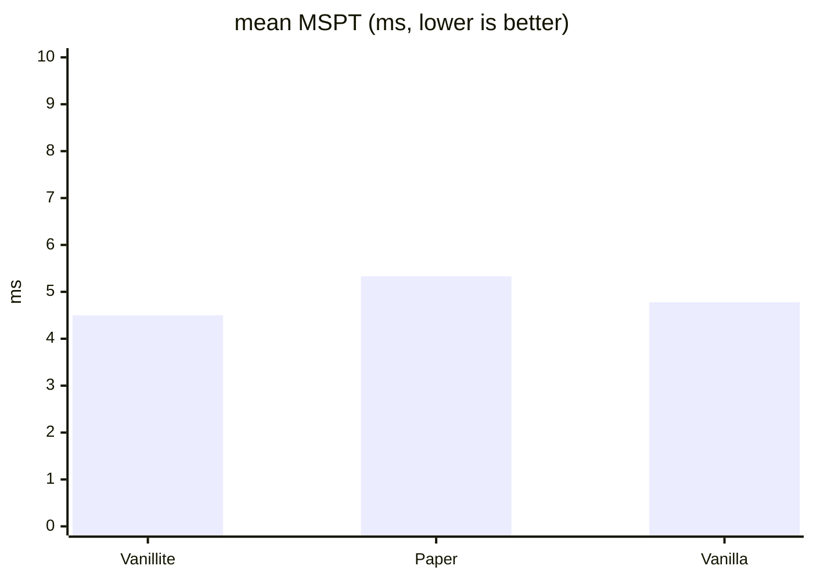

Notes:

- Paper: from an earlier run (2026-11-25 04:09 UTC, dev `unknown`), not measured in this one
- Vanilla: from an earlier run (2026-11-25 04:09 UTC, dev `unknown`), not measured in this one
- Pumpkin: from an earlier run (2026-11-25 04:09 UTC, dev `unknown`), not measured in this one
- Pumpkin: command not supported: ...aft:hopper[facing=east]{Items:[{Slot:0b,id:"minecraft:cobblestone",count:64}]}<--[HERE]

## TNT: chain explosions

A 16 × 10 × 16 block of TNT (2 560) ignited in the air every 20 s, three times. Run 2026-11-27 04:42 UTC on dev `24e7176e9b65`.

| Server | MSPT mean | p50 | p95 | p99 | max | CPU % | RSS MiB |
|---|---:|---:|---:|---:|---:|---:|---:|
| Vanillite | 12.92 | 3.62 | 90.56 | 171 | 318 | 27.41 | 462 |
| Paper | 7.98 | 6.92 | 15.98 | 32.62 | 98.3 | 29.61 | 1617 |
| Vanilla | 19.08 | 3.01 | 81.86 | 242 | 539 | 43.87 | 1320 |
| Pumpkin | – | – | – | – | – | 1.7 | 198 |

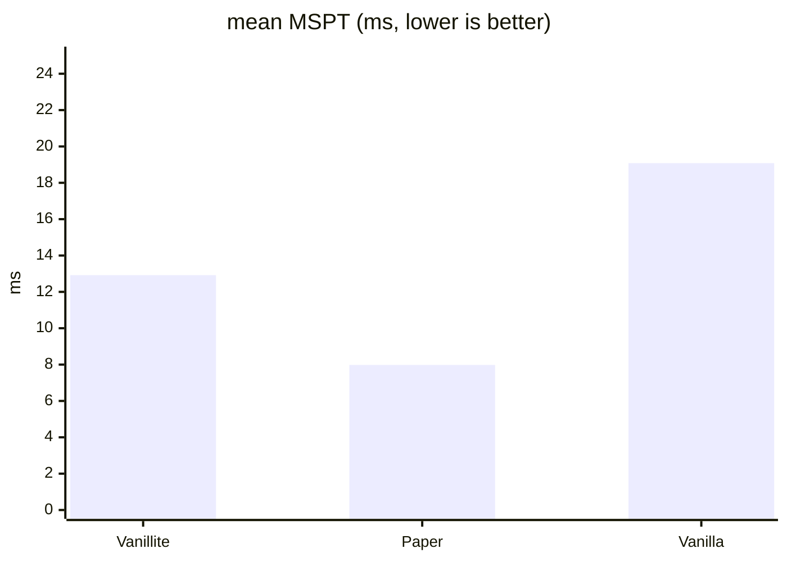

Notes:

- Paper: from an earlier run (2026-11-25 04:09 UTC, dev `unknown`), not measured in this one
- Vanilla: from an earlier run (2026-11-25 04:09 UTC, dev `unknown`), not measured in this one
- Pumpkin: from an earlier run (2026-11-25 04:09 UTC, dev `unknown`), not measured in this one

## Flowing water and lava

32 water and 32 lava sources placed on a walled 64 × 64 platform, removed again 10 s later, in turns (spreading and drying up). Run 2026-11-27 04:42 UTC on dev `24e7176e9b65`.

| Server | MSPT mean | p50 | p95 | p99 | max | CPU % | RSS MiB |
|---|---:|---:|---:|---:|---:|---:|---:|
| Vanillite | 4.06 | 3.18 | 9 | 23.07 | 33.86 | 24.92 | 478 |
| Paper | 5.05 | 4.55 | 9.44 | 21.05 | 46.4 | 18.92 | 1531 |
| Vanilla | 5.28 | 4.68 | 8.53 | 20.83 | 50.5 | 19.23 | 1281 |
| Pumpkin | – | – | – | – | – | 2.11 | 198 |

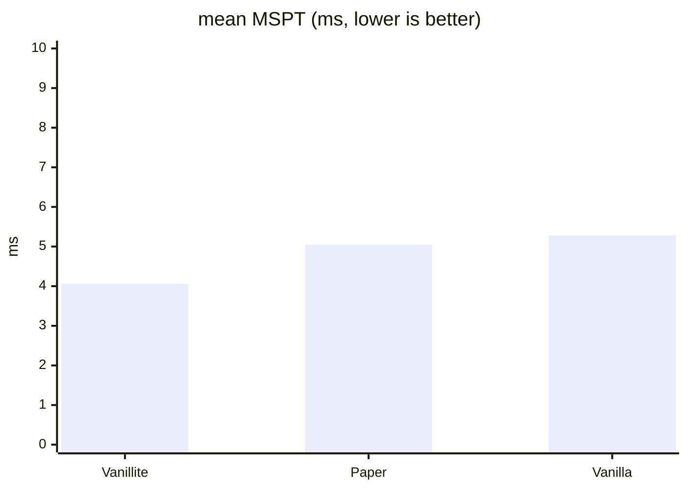

Notes:

- Paper: from an earlier run (2026-11-25 04:09 UTC, dev `unknown`), not measured in this one
- Vanilla: from an earlier run (2026-11-25 04:09 UTC, dev `unknown`), not measured in this one
- Pumpkin: from an earlier run (2026-11-25 04:09 UTC, dev `unknown`), not measured in this one

## Light updates

A 32 × 32 × 32 cube filled with glowstone and emptied again every 2 s (32 768 light sources appearing and disappearing, with block updates). Run 2026-11-27 04:42 UTC on dev `24e7176e9b65`.

| Server | MSPT mean | p50 | p95 | p99 | max | CPU % | RSS MiB |
|---|---:|---:|---:|---:|---:|---:|---:|
| Vanillite | 4.87 | 2.55 | 8.38 | 77.54 | 130 | 14.37 | 461 |
| Paper | 4.18 | 3.78 | 6.88 | 12.73 | 37.7 | 22.38 | 1618 |
| Vanilla | 5.76 | 5.17 | 9.23 | 23.97 | 47.5 | 36.82 | 1303 |
| Pumpkin | – | – | – | – | – | 1.97 | 196 |

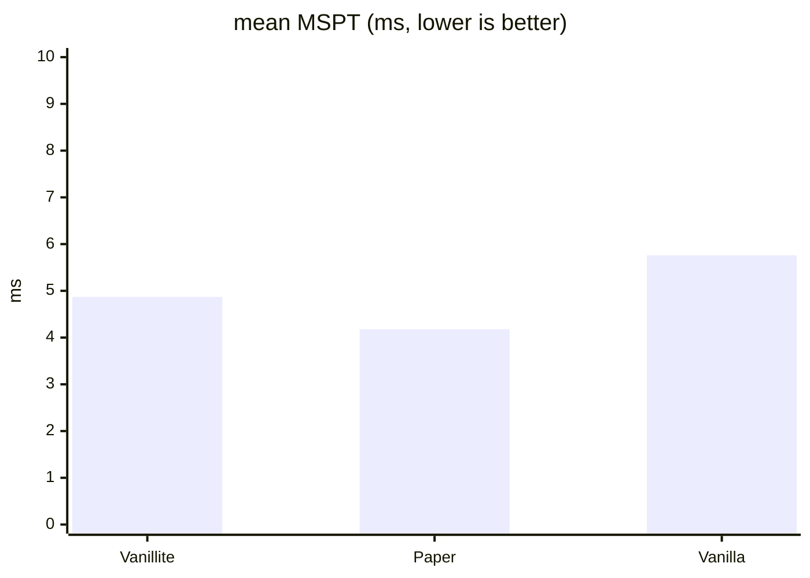

Notes:

- Paper: from an earlier run (2026-11-25 04:09 UTC, dev `unknown`), not measured in this one
- Vanilla: from an earlier run (2026-11-25 04:09 UTC, dev `unknown`), not measured in this one
- Pumpkin: from an earlier run (2026-11-25 04:09 UTC, dev `unknown`), not measured in this one

## World save

20 bots fly at boat speed (72.7 blocks/s) through new terrain for 60 s, then `save-all flush` until the server reports that everything is on disk. Run 2026-11-27 04:42 UTC on dev `24e7176e9b65`.

| Server | save-all flush s | Chunks on disk after | Chunks on disk / save s | Chunks/s to the bots while flying | MSPT p95 while flying |
|---|---:|---:|---:|---:|---:|
| Vanillite | 2.77 | 19788 | 7149 | 521 | 1406 |
| Paper | 1.86 | 4373 | 2357 | 4.12 | – |
| Vanilla | 5.49 | 5806 | 1058 | 181 | 105 |

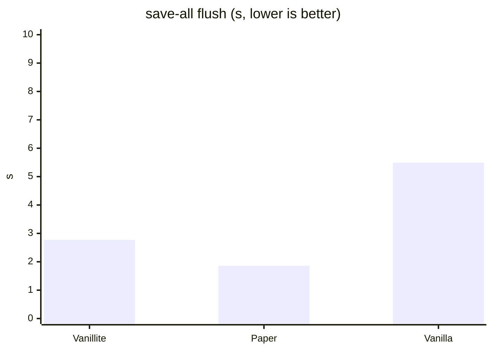

Notes:

- Vanillite: chunks on disk counted after the run (the count did not know the .vwr format yet)
- Paper: from an earlier run (2026-11-25 04:09 UTC, dev `unknown`), not measured in this one
- Vanilla: from an earlier run (2026-11-25 04:09 UTC, dev `unknown`), not measured in this one

## World pre-generation

Generate the 101 × 101 chunks (10 201) around 0, 0 on 4 cores (Vanillite also on 1 and 2 threads), median of 3 runs. Vanillite: the chunk pipeline benchmark (`chunk_bench`: generation, light, storage, then loading the same chunks from disk). Paper: the Chunky plugin (radius 800, square) in the running server. Run 2026-11-25 04:09 UTC on dev `unknown`.

| Server | Chunks/s | Chunks/s with 1 / 2 threads | CPU ms per chunk | First chunk ms | Peak RSS MiB | Load from disk chunks/s | Method |
|---|---:|---:|---:|---:|---:|---:|---:|
| Vanillite | 248 | 59.1 / 113 | 14.75 | 1868 | 357 | 11830 | `chunk_bench --radius 32 --threads 4 --pump --load` |
| Paper | 60.96 | – / – | 24.54 | – | – | – | `Chunky 1.5.66: chunky radius 512, shape square, start` |

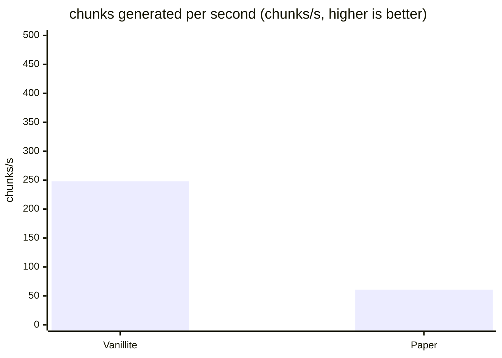

## Proxy relay

Players join through a proxy on 30900 into Vanillite on 30901 (modern forwarding) and walk randomly: cost of the proxy process. Run 2026-11-25 04:09 UTC on dev `unknown`.

| Server | Players | MSPT p50 | p95 | p99 | max | RSS MiB | RSS per player KiB | CPU % | Out KB/s per player | Join: ramp s / p95 ms | RTT p95 ms | Chunks/s per bot | Server CPU ms per chunk | Full view p95 ms | Holes near players % | Teleports |
|---|---:|---:|---:|---:|---:|---:|---:|---:|---:|---:|---:|---:|---:|---:|---:|---:|
| vanillite-proxy | 100 / 100 | – | – | – | – | 14.93 | 109 | 11.78 | 62.5 | 9 / 123 | 0.21 | 7.6 | 0.16 | 2143 | 0 | 0 |
| vanillite-proxy | 500 / 500 | – | – | – | – | 54.61 | 103 | 78.02 | 138 | 22 / 69.87 | 12.36 | 7.63 | 0.2 | 324 | 0 | 0 |
| Velocity | 100 / 100 | – | – | – | – | 647 | 4867 | 47.9 | 59.9 | 17 / 2222 | 6.48 | 7.57 | 0.63 | 9749 | 0 | 0 |
| Velocity | 500 / 500 | – | – | – | – | 1034 | 1765 | 257 | 90.74 | 60.01 / 1765 | 758 | 7.35 | 0.7 | 2743 | 0 | 0 |

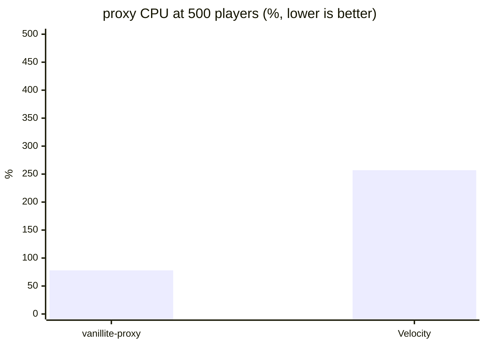

## Flying players: chunk delivery

Bots fly straight at y 300 in random directions, first 50 with elytra speed (33.5 blocks/s), then 100 at boat speed (72.7 blocks/s): new terrain is generated and sent all the time; the movement check game rule is off on every server. Holes: chunks within 2 chunks of a bot that it does not have, sampled every 5 s. Full view: from connecting until every chunk within the view distance (circle) is there. Server CPU per chunk: CPU time of the server process divided by the chunks the bots received. Run 2026-11-25 04:09 UTC on dev `unknown`.

| Server | Players | MSPT p50 | p95 | p99 | max | RSS MiB | RSS per player KiB | CPU % | Out KB/s per player | Join: ramp s / p95 ms | RTT p95 ms | Chunks/s per bot | Server CPU ms per chunk | Full view p95 ms | Holes near players % | Teleports |
|---|---:|---:|---:|---:|---:|---:|---:|---:|---:|---:|---:|---:|---:|---:|---:|---:|
| Vanillite | 50 / 50 | 6.05 | 17.22 | 24.1 | 223 | 844 | 10764 | 303 | 3 | 4 / 75.63 | 3.09 | 0.12 | 522 | – | 99.98 | 0 |
| Vanillite | 100 / 100 | 31.63 | 61.7 | 83.66 | 132 | 1470 | 11784 | 269 | 5 | 4 / 72.34 | 3.41 | 0.5 | 53.9 | – | 99.01 | 0 |
| Paper (failed) | 0 / 50 | – | – | – | – | 0 | – | – | – | 101 / 3522 | – | – | – | – | – | 0 |
| Vanilla (failed) | 50 / 50 | – | – | – | – | 2586 | 31226 | 292 | 10.2 | 8 / 2013 | 3.02 | 0 | – | – | 100 | 0 |
| Vanilla (failed) | 0 / 100 | – | – | – | – | 0 | – | – | – | 43.01 / – | – | – | – | – | – | 0 |
| Pumpkin | 50 / 50 | – | – | – | – | 937 | 18108 | 208 | 3.8 | 4 / 314 | 52.36 | 0.68 | 61.21 | 3843 | 98.46 | 0 |
| Pumpkin | 100 / 100 | – | – | – | – | 1282 | 12589 | 183 | 2 | 3 / 101 | 52.54 | 0.05 | 336 | – | 99.94 | 0 |

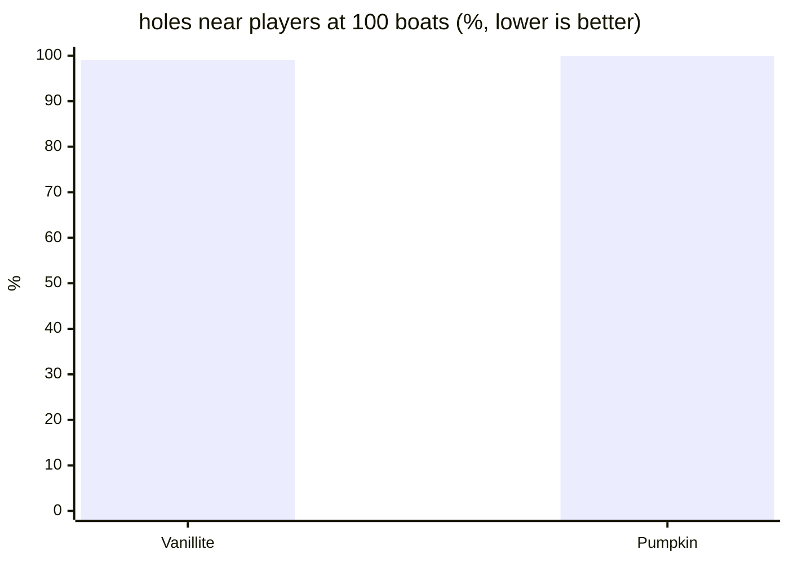

Notes:

- Paper: failed at 50 players (0 online)
- Vanilla: failed at 100 players (0 online)

## Players spread out

Bots fly to random points within 1 500 blocks of the spawn and stay there: every player has its own chunks. Run 2026-11-25 04:09 UTC on dev `unknown`.

| Server | Players | MSPT p50 | p95 | p99 | max | RSS MiB | RSS per player KiB | CPU % | Out KB/s per player | Join: ramp s / p95 ms | RTT p95 ms | Chunks/s per bot | Server CPU ms per chunk | Full view p95 ms | Holes near players % | Teleports |
|---|---:|---:|---:|---:|---:|---:|---:|---:|---:|---:|---:|---:|---:|---:|---:|---:|
| Vanillite | 100 / 100 | 42 | 70.71 | 97.52 | 124 | 929 | 6280 | 351 | 6.7 | 7 / 164 | 2.76 | 0.79 | 44.58 | – | 75.62 | 0 |
| Vanillite | 250 / 250 | 129 | 211 | 272 | 304 | 1287 | 3980 | 364 | 6.64 | 9 / 302 | 2.98 | 0.8 | 18.26 | 1136 | 61.7 | 0 |
| Vanillite | 500 / 500 | 291 | 552 | 600 | 730 | 1694 | 2822 | 320 | 7.22 | 31.07 / 695 | 7.05 | 0.72 | 8.89 | 185362 | 44.03 | 0 |
| Vanillite (paper profile) | 100 / 100 | 41.36 | 71.51 | 92.32 | 150 | 847 | 5449 | 282 | 5.2 | 8.01 / 116 | 5.67 | 0.4 | 70.95 | – | 80.97 | 0 |
| Vanillite (paper profile) | 250 / 250 | 117 | 198 | 241 | 272 | 1155 | 3445 | 323 | 5.28 | 9.02 / 279 | 5.28 | 0.56 | 23.24 | 8275 | 68.49 | 0 |
| Vanillite (paper profile) | 500 / 500 | 181 | 349 | 436 | 496 | 1500 | 2428 | 343 | 6.28 | 27.02 / 658 | 3.61 | 0.69 | 9.98 | 3098 | 54.84 | 0 |
| Paper (failed) | 0 / 100 | – | – | – | – | 0 | – | – | – | 107 / 2250 | – | – | – | – | – | 0 |
| Vanilla (failed) | 0 / 100 | – | – | – | – | 0 | – | – | – | 108 / 1982 | – | – | – | – | – | 0 |
| Pumpkin | 100 / 100 | – | – | – | – | 1985 | 19787 | 178 | 4.6 | 7 / 408 | 50.16 | 0.69 | 25.59 | – | 85.15 | 0 |
| Pumpkin | 250 / 250 | – | – | – | – | 3669 | 14813 | 316 | 21.04 | 15 / 892 | 113 | 4.2 | 3 | 4315 | 26.36 | 0 |
| Pumpkin | 500 / 500 | – | – | – | – | 5510 | 11177 | 336 | 7.22 | 56.01 / 2302 | 234 | 1.11 | 6.04 | 284814 | 0 | 0 |

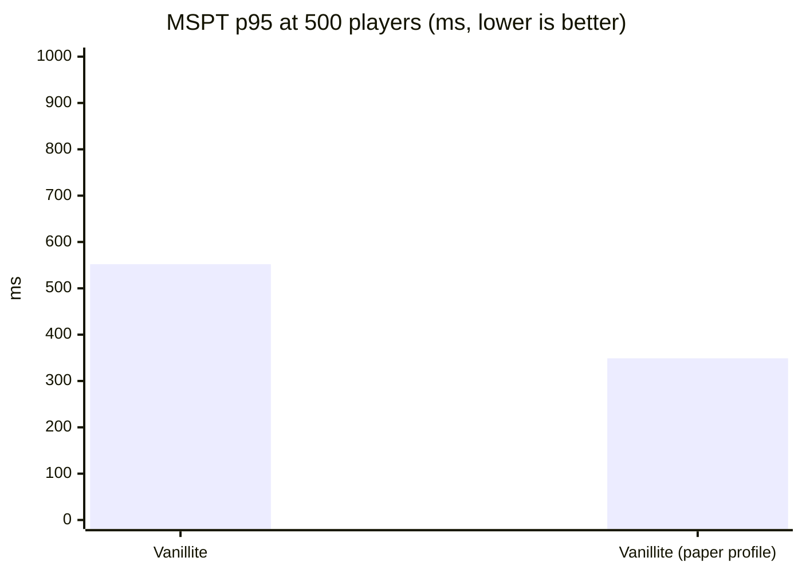

Notes:

- Paper: failed at 100 players (0 online)
- Vanilla: failed at 100 players (0 online)

## Join storm

1 000 bots join at 20 per second; then 1 000 more connect at once (up to 256 logins at the same time). Run 2026-11-25 04:09 UTC on dev `unknown`.

| Server | Players | MSPT p50 | p95 | p99 | max | RSS MiB | RSS per player KiB | CPU % | Out KB/s per player | Join: ramp s / p95 ms | RTT p95 ms | Chunks/s per bot | Server CPU ms per chunk | Full view p95 ms | Holes near players % | Teleports |
|---|---:|---:|---:|---:|---:|---:|---:|---:|---:|---:|---:|---:|---:|---:|---:|---:|
| Vanillite (failed) | 1000 / 1000 | 21.82 | 28.59 | 33.58 | 35.63 | 569 | 260 | 130 | 239 | 51.01 / 59.08 | 12.47 | 7.56 | 0.17 | 354 | 0 | 0 |
| Vanillite (failed) | 1744 / 2000 | 55.43 | 68.72 | 86.45 | 93.12 | 802 | 285 | 262 | 345 | 39.08 / 3299 | 48.18 | 7.57 | 0.2 | 3642 | 0 | 0 |
| Vanillite (paper profile) (failed) | 1000 / 1000 | 21.11 | 27.33 | 33.46 | 44.91 | 573 | 262 | 128 | 239 | 52.01 / 45.3 | 1.74 | 7.5 | 0.17 | 480 | 0 | 0 |
| Vanillite (paper profile) (failed) | 1814 / 2000 | 48.12 | 62.24 | 71.61 | 73.24 | 813 | 280 | 273 | 352 | 41.01 / 4097 | 122 | 5.55 | 0.27 | 4498 | 0 | 0 |
| Paper (failed) | 256 / 1000 | – | – | – | – | 3860 | 9812 | 373 | 135 | 664 / 58787 | 950 | 1.32 | 11.07 | 61316 | 0.67 | 163 |
| Vanilla (failed) | 0 / 1000 | – | – | – | – | 0 | – | – | – | 158 / 6448 | – | – | – | – | – | 0 |
| Pumpkin (failed) | 310 / 1000 | – | – | – | – | 3809 | 12436 | 383 | 207 | 219 / 2811 | 34088 | 9.51 | 1.33 | 62232 | 0 | 0 |

Notes:

- Vanillite: failed at 2000 players (1744 online)
- Vanillite (paper profile): failed at 2000 players (1814 online)
- Paper: failed at 1000 players (256 online)
- Vanilla: failed at 1000 players (0 online)
- Pumpkin: failed at 1000 players (310 online)

