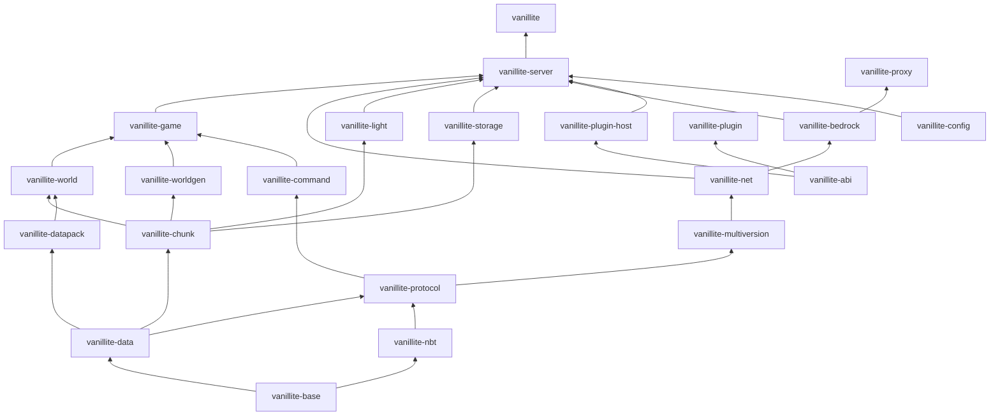
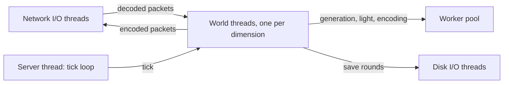

# Architecture overview

Vanillite is one Cargo workspace. Crates live in `crates/`, developer tools in `tools/` and
`xtask/`, the example plugin in `examples/`. This page is the map; the pages next to it go into
detail:

- [Server, configuration and tick loop](server-and-config.md)
- [World access: reads, writes and chunk loads](world-access.md)
- [Worlds: formats, layouts, saving and backups](../worlds.md)
- [Plugin development](../plugins.md)

## Crates

| Crate | Role |
|---|---|
| `vanillite-base` | Java-exact maths and random generators, positions, bounding boxes, slot maps, bit sets, the per-tick arena. |
| `vanillite-data` | Tables generated at build time from Mojang's data (`vanillite-datagen`: extracted from the server jar pinned in `data/vanilla/version.toml` into a per-machine cache): block states and their facts, shapes, registries, protocol ids, entity and item facts. |
| `vanillite-nbt` | NBT and SNBT with a budgeted streaming reader and writer. |
| `vanillite-macros` | `#[derive(Packet)]`, the rule catalogue and behaviour tables. |
| `vanillite-protocol` | The Java protocol without I/O: primitives, framing, packets, text components. |
| `vanillite-config` | `server.properties`, `vanillite.toml`, profiles and the rule catalogue. |
| `vanillite-chunk` | The in-memory chunk: paletted sections, light, heightmaps, chunk packet encoding; the storage slot contract. |
| `vanillite-datapack` | Data packs: dynamic registries, tags, recipes, loot tables, advancements, world generation settings. |
| `vanillite-world` | World runtime without gameplay: chunk map, tickets, chunk scheduler, block access and updates, scheduled ticks, entity store. |
| `vanillite-worldgen` | Vanilla world generation: noise, biomes, surface rules, carvers, features, structures. |
| `vanillite-light` | The light engine. |
| `vanillite-command` | Brigadier-compatible command tree, argument parsers and suggestions. |
| `vanillite-game` | Gameplay: the level tick, block behaviours, entities and mob AI, physics, items, inventories, players and commands. |
| `vanillite-storage` | Persistence: the own world format and Anvil, entities, POI, player data, `level.dat`, layouts, conversion, backups. |
| `vanillite-net` | The network pipeline: listener, I/O threads, connection states, authentication, compression, encryption, rate limits. |
| `vanillite-multiversion` | Translation of older clients' packets to the server's version and back. |
| `vanillite-bedrock` | The Bedrock frontend: RakNet, Xbox Live login and Bedrock ↔ Java translation over virtual connections. |
| `vanillite-abi`, `vanillite-plugin-host`, `vanillite-plugin` | The plugin C ABI, its host in the server, and the Rust SDK. |
| `vanillite-server` | Startup, slot wiring, tick loop, world threads, worker pool, autosave, shutdown, watchdog. |
| `vanillite` | The binary: a thin command line over `vanillite-server`. |
| `vanillite-proxy` | The Velocity-compatible proxy. |
| `vanillite-test` | Test harness: headless worlds, parity scenarios against Vanilla, goldens. |

## Principles

- **Vanilla parity in game, freedom inside.** Everything a player can observe follows Vanilla:
  the same random calls in the same order, the same tick order. How the server gets there
  (data layout, threads, storage) is free. Parity is enforced by tests that run the same
  scenario in Mojang's server and in Vanillite and compare every tick
  ([development guide](../development.md#parity-tests)).
- **Deviations are rules.** Every behaviour that differs from Vanilla, and every setting, is one
  declaration in the rule catalogue of `vanillite-config`, with a value per profile. The
  `vanilla` profile deviates only to close security holes.
- **Replaceable systems (slots).** The scheduler, chunk storage, chunk generator, light engine
  and entity tracker are slots: traits with one built-in implementation that a plugin or an
  embedding program can replace at startup. The server calls the filled implementation
  directly; there is no extra indirection on hot paths.
- **No global state, no main thread.** State lives with the world (and below it with chunks
  and sections) that owns it. Code takes the owner it works on, so worlds can tick on their
  own threads.
- **Batches and fan-out.** Work is done once and shared: a chunk or entity update is encoded
  once and sent to every viewer; storage reads and writes go in batches.
- **Untrusted input is bounded.** Packets, NBT and stored files are decoded under size and
  depth budgets; errors are reported per connection or per chunk instead of panicking.

## Threads

- The **server thread** runs Vanilla's tick loop (50 ms per tick, catch-up, tick rate commands)
  and the server-wide phases of a tick.
- Each **world** is owned by one thread. With `performance.tick.parallel-dimensions` the worlds
  tick in parallel; in the `vanilla` and `technical` profiles they tick one after another in
  Vanilla's order.
- The **worker pool** (`performance.threads.compute`) runs world generation, light, chunk
  encoding, compression and parallel parts of a tick. On a machine with fewer than two cores
  background work runs only between ticks, so the tick stays smooth.
- **Network I/O threads** read, decode, encode and write packets; **disk I/O threads**
  (`storage.io-threads`) only read and write files.

## A chunk's way to the player

1. A player's view creates chunk tickets; the chunk scheduler (`vanillite-world`) asks the
   storage slot for the chunk and generates it with the generator slot when it does not exist.
2. Generation and light run on the worker pool; the finished chunk joins its world.
3. The chunk packet is encoded once and sent to every player who sees the chunk; clients of
   older versions and Bedrock clients get it through their translation layer.
4. Changed chunks are saved in save rounds after the world tick and on unload, and written by
   the disk I/O threads.
